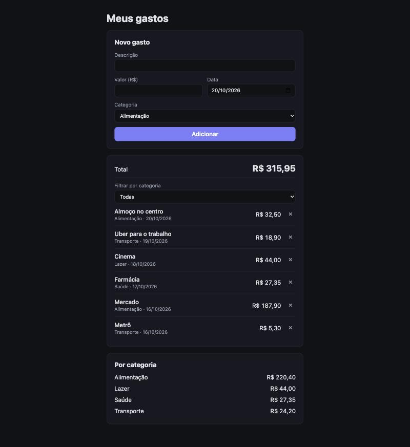

# Meus gastos — SDD com OpenSpec

App web pequeno (React + Vite + TypeScript) para controle de gastos pessoais, construído com **Spec-Driven Development** usando o [OpenSpec](https://openspec.dev/).



## O que é SDD

Em vez de começar pelo código, cada mudança começa por uma **especificação**: o que o sistema deve fazer, com cenários verificáveis (WHEN/THEN). O código é implementado a partir da spec, e a spec continua sendo a fonte da verdade depois que a mudança é entregue.

## Fluxo OpenSpec usado

```
proposal.md  →  specs/<capability>/spec.md  →  design.md  →  tasks.md  →  código + testes  →  archive
   (por quê)        (o quê — delta)              (como)       (passos)                           (spec vira fonte da verdade)
```

| Etapa | Comando | Resultado |
| --- | --- | --- |
| Inicializar | `openspec init --tools claude --language pt-BR` | Cria `openspec/` e os comandos `/opsx:*` do Claude Code |
| Propor | `/opsx:propose` ou `openspec new change <nome>` | `openspec/changes/<nome>/` com proposal, spec delta, design e tasks |
| Validar | `openspec validate <nome> --strict` | Garante formato da spec (requisitos com SHALL/MUST e cenários) |
| Implementar | `/opsx:apply` | Código e testes seguindo `tasks.md` |
| Arquivar | `openspec archive <nome>` | Mescla o delta em `openspec/specs/` e move a change para `changes/archive/` |

## Changes deste projeto

1. **`add-expense-tracking`** — registrar, listar, remover, totalizar e persistir gastos (cria a capability `expense-tracking`).
2. **`add-category-filter`** — filtrar por categoria e mostrar total por categoria (delta `ADDED` sobre a capability existente).

Veja o histórico em [`openspec/changes/archive/`](openspec/changes/archive/) e a spec atual em [`openspec/specs/`](openspec/specs/).

## Rodando

Requer Node 20.19+.

```bash
npm install
npm run dev
npm test
```

Cada cenário da spec tem um teste correspondente em `src/*.test.ts(x)`.
